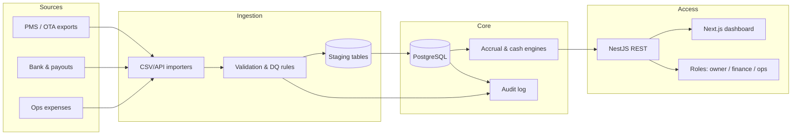

# Architecture (target state)

## Idempotent re-import

- Natural keys: `reservation_id + updated_at`, `payment_id`, `expense_id`.
- Upsert into staging, then merge into canonical tables in a transaction.
- `import_runs` table stores file hash, row counts, and diff summary.

## Audit & access

- Row-level `owner_id` on properties; finance sees all, owners see their portfolio.
- Immutable `financial_events` for posted management fees and owner statements.
- JWT + refresh tokens (prototype); production: SSO and scoped API keys for integrations.
